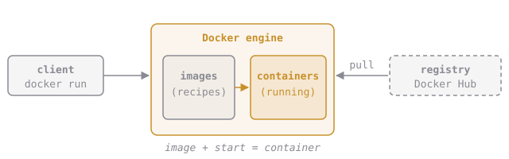

# The Parts of Docker

You've seen a few new words. Here's the whole cast in one picture:

| Part | What it is | Everyday version |
| --- | --- | --- |
| **Client** | The `docker` command you type | A TV remote |
| **Engine** (daemon) | The background program that does the work | The TV |
| **Image** | A packed, read-only box of an app and its files | A recipe |
| **Container** | A running copy made from an image | A cake made from the recipe |
| **Registry** | An online shop full of images. **Docker Hub** is the big public one | A recipe library |

So when you ran `docker run hello-world`:

1. The **client** sent "run hello-world" to the **engine**.
2. The engine didn't have the **image**, so it downloaded (*pulled*) it from the **registry**.
3. The engine started a **container** from that image.

**What happens when you type `docker run nginx` and nginx isn't on your computer yet?**
