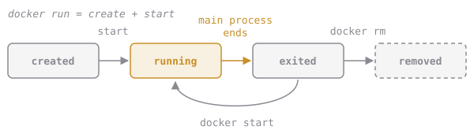

# Keep It Running

Try starting a container from Alpine (a tiny Linux distribution) and listing what's running:

```sh
docker run alpine:3.20
docker ps
# CONTAINER ID   IMAGE   COMMAND   CREATED   STATUS   PORTS   NAMES
```

It's empty. The container started and exited straight away. That isn't a crash.

A container lives exactly as long as its **main process**:



Alpine's default command is `sh`, and a shell with no terminal attached has nothing to read, so it exits at once and takes the container with it. `docker ps -a` (`-a` for *all*, stopped ones included) shows the corpse:

```sh
docker ps -a
# ... alpine:3.20  "/bin/sh"  ...  Exited (0) 3 seconds ago  ...
```

To keep a container alive, give it a main process that doesn't finish. You'll also want two flags on almost every `docker run`:

```sh
docker run -d --name eb-demo alpine:3.20 sleep 300
#          │   │                         └── the command: replaces the image's default
#          │   └── a name you choose, instead of a random one like "jolly_turing"
#          └── detached: run in the background and give your terminal back
```

## Assignment

Dex, our on-call SRE, needs a long-lived container to poke at in the next lesson.

1. Start a container named **`eb-hello`** from **`alpine:3.20`**, **detached**, whose command keeps it alive for as long as it's needed. `sleep infinity` does exactly that.
2. Check it with `docker ps`. Its STATUS should start with `Up`.
3. From `~/elixirbytes`, run `codequest run dk.containers.keep-running`, then `codequest submit dk.containers.keep-running`.

The checks look at `eb-hello`'s status, its image and whether it was started detached.

If the name is taken from an earlier attempt, remove the old one with `docker rm -f eb-hello` and start again.
