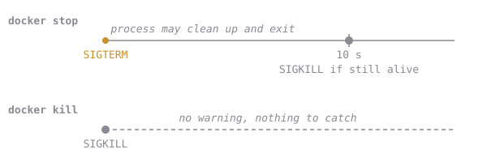

# Kill vs Stop

There are two ways to end a running container, and they aren't the same. A **signal** is a small message the kernel delivers to a process: SIGTERM (number 15) means "please finish up", and SIGKILL (number 9) can't be caught at all.



When a process is *ended by* a signal instead of exiting on its own, the shell convention is to report **128 + the signal number**. So:

```
128 + 9  = 137   killed (SIGKILL)
128 + 15 = 143   terminated (SIGTERM) and didn't handle it
```

Once you know that formula, a stopped container's exit code tells you how it died.

There's a catch. Try `docker stop` on a container running `sleep`:

```sh
docker run -d --name eb-demo alpine:3.20 sleep 300
time docker stop eb-demo
# real  0m10.2s       <- ten whole seconds
docker inspect -f '{{.State.ExitCode}}' eb-demo
# 137                 <- killed, not terminated
```

As PID 1, `sleep` ignored SIGTERM, so after 10 s Docker used SIGKILL. *Why* is chapter 5. For today, `--init` puts a tiny init process in front of `sleep` that passes the signal along.

## Assignment

- Start **`eb-sleepy`** from `alpine:3.20`, detached, running `sleep 300`. Then end it with **`docker kill`**.
- Start a container named `eb-polite` using `alpine:3.20` in detached mode with `--init` enabled, running `sleep 300`. Use `docker stop eb-polite` to terminate it. The `--init` flag runs a lightweight init process as PID 1 to handle signal forwarding and zombie-process reaping, unlike running `sleep` directly as PID 1 (Don't worry we will see it later). The operation should take well under a second.
- Look at both exit codes and check them against the table, then submit.

The checks look at each container's exit code and whether it was out of memory (it wasn't), and confirm `eb-polite` was started with `--init`.
