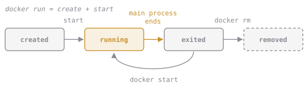

# A Container's Life

Every container moves through the same few states:

1. **created**: Docker set it up but hasn't started it.
2. **running**: its main command is running.
3. **exited**: the main command ended. The container is stopped but still there, with everything it printed.
4. **removed**: you deleted it with `docker rm`. Now it's really gone.

`docker run` is just a shortcut for *create* + *start*.

The **main command** is the important part. A web server runs forever, so its container keeps running. A command like `echo` or `ls` finishes in a blink, so its container goes straight to exited.

**`cq-first` from the last lesson shows `Exited (0)` in `docker ps -a`. What does that mean?**
