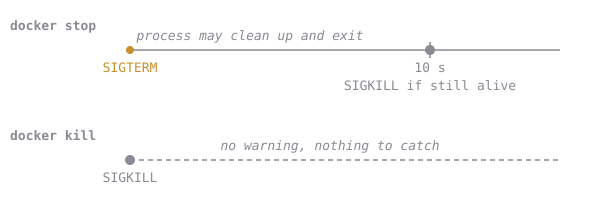

# Stop vs Kill

Time to explain that 10-second wait from earlier.

There are two ways to stop a container:

- **`docker stop`** asks politely. It sends a message (a *signal* called `SIGTERM`) that means "please finish up and exit". A well-behaved app saves its work and stops right away. If the app is still running after **10 seconds**, Docker gives up asking and forces it.
- **`docker kill`** forces it immediately (`SIGKILL`). No warning, no cleanup. It's like pulling the power plug.

The exit code tells you which happened:

| Exit code | Meaning |
| --- | --- |
| 0 | The app stopped by itself, happily |
| 143 | The app accepted the polite request and stopped |
| 137 | The app was **forced** to stop |

Use `docker stop` by default. Use `docker kill` only when an app is stuck.

You'll learn how to make your own apps stop instantly in the ENTRYPOINT chapter.

**`docker stop cq-sleeper` took 10 seconds, and afterwards the status said `Exited (137)`. What happened?**
