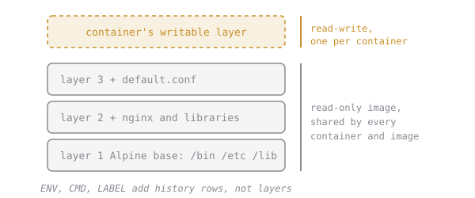

# Count the Layers

An image isn't one big blob. It's a stack of **layers**, each a tarball of file changes. A container sees them merged into one filesystem, with its own writable layer on top:



Layers are shared, so ten images built `FROM alpine:3.20` store Alpine's layer once.

There are two ways to look at them, and they don't agree:

```sh
docker history nginx:1.27-alpine
# IMAGE   CREATED BY                          SIZE
# ...     CMD ["nginx" "-g" "daemon off;"]    0B
# ...     COPY docker-entrypoint.sh /         8.19kB
# ...     ENV NGINX_VERSION=1.27.5            0B
# ...     (many more rows)

docker image inspect -f '{{json .RootFS.Layers}}' nginx:1.27-alpine
# ["sha256:...", "sha256:...", ...]
```

`docker history` shows every build **step**, including ones that only set metadata (`ENV`, `CMD`, `LABEL`, `EXPOSE`). Those are the rows with `0B`, and they add no files. `RootFS.Layers` lists only the real filesystem layers.

## Assignment

Dex wants to know how many filesystem layers our future web front end has.

1. `docker pull nginx:1.27-alpine`
2. Find how many **filesystem layers** it has. Not history rows: layers. A Go template can count a list with `{{len ...}}`.
3. In `~/elixirbytes`, create `answers.txt` (if it doesn't exist) and add the line:

   ```
   nginx_layers=N
   ```

   with your number in place of `N`, no spaces. Later lessons add more `key=value` lines to this file.

4. Submit from `~/elixirbytes`. The first check counts the layers itself; the second looks for exactly your line in `answers.txt`.
