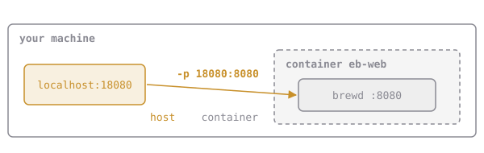

# Open the Shop Door

Start brewd detached and try to reach it:

```sh
docker run -d --name eb-demo elixirbytes/brewd:v1
curl localhost:8080/healthz
# curl: (7) Failed to connect to localhost port 8080: Connection refused
```

brewd *is* listening on 8080, but on the container's own network, not your machine's. Each container gets a private network namespace, and nothing gets in unless you **publish** a port:

```sh
docker run -d -p 18080:8080 elixirbytes/brewd:v1
```



Read `-p` as **host:container**, outside first.

`docker port <name>` shows what's published.

## Assignment

1. Remove any `eb-demo` you made (`docker rm -f eb-demo`).
2. Run **`eb-web`** from **`elixirbytes/brewd:v1`**, detached, so that **`http://localhost:18080/healthz`** on your machine reaches brewd.
3. Check it with `curl localhost:18080/healthz`, which should print `ok`.
4. Submit from `~/elixirbytes`. The checks inspect `eb-web`'s ports, then make two real HTTP requests to `localhost:18080`.

If port 18080 is already in use on your machine, pick another host port and run `codequest config base_url http://localhost:<port>`. The port check also needs `:18080`, so freeing 18080 is easier.
