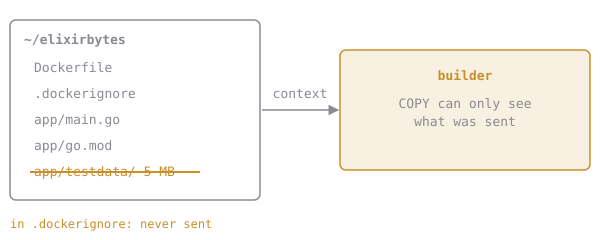

# Leave the Junk Behind

Check what's in your v1 image:

```sh
docker run --rm elixirbytes/brewd:v1 ls /src
# go.mod  main.go  testdata
```

`COPY app/ .` copied *everything*, 5 MB of fixtures included. In a real repo that also means `.git`, `node_modules`, local `.env` files with passwords in them... all sent to the builder and possibly baked into an image you then push somewhere public.

A **`.dockerignore`** file in the root of the build context lists paths to leave out, one pattern per line, using the same idea as `.gitignore`:

```
# .dockerignore
.git
*.log
secrets/
docs/**/*.pdf
```

Patterns are relative to the **context root**, not to the Dockerfile and not to the `COPY` source. Ignored files never leave your machine, so no `COPY` can pick them up:



## Assignment

1. Create **`~/elixirbytes/.dockerignore`** that keeps `app/testdata` out of the build context.
2. Rebuild as **`elixirbytes/brewd:lean`**. Watch `transferring context:` drop from about 5 MB to a few kB.
3. Check it with `docker run --rm elixirbytes/brewd:lean ls /src`.
4. Submit from `~/elixirbytes`. The checks read `.dockerignore`, list `/src` in the new image and run brewd in it.
