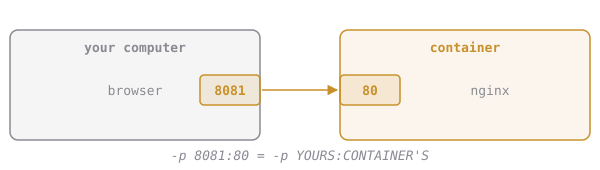

# Which Side Is Which?

Everyone mixes up the two numbers in `-p` at first. Here's the rule:

**`-p YOURS:CONTAINER'S`.** Left is your computer, right is inside the box.

- The **right** number is decided by the app. nginx listens on 80, so it's always `:80`.
- The **left** number is your choice. Any free port works.

That's how you can run three copies of nginx at once: `-p 8081:80`, `-p 8082:80`, `-p 8083:80`. Three different doors on your computer, each leading to port 80 in a different box.

**An app inside a container listens on port 3000. You want to open it at http://localhost:5432. Which flag do you need?**
