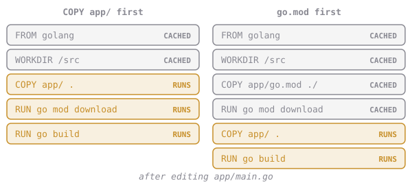

# Dependencies First

The fix for the four-minute build is all about order. **Put the things that change least at the top.**

`go.mod` (and `go.sum`, once there are dependencies) list what to download. They change once a month. The `.go` files change ten times a day. So copy the dependency list on its own, download, and only *then* copy the rest:

```dockerfile
COPY app/go.mod ./        # cache key: checksum of go.mod only
RUN go mod download       # reused as long as go.mod is unchanged
COPY app/ .               # source edits only invalidate from here down
RUN go build ...
```



Every ecosystem has the same trick: `package.json` before `npm ci`, `requirements.txt` before `pip install`, `Cargo.toml` before `cargo fetch`.

> brewd has no third-party dependencies yet, so `go mod download` finishes instantly today. We're fixing the structure before it hurts, not after.

`docker history` lists an image's steps **newest first**, so you can check the order without opening the Dockerfile:

```sh
docker history --format '{{.CreatedBy}}' elixirbytes/brewd:v1
```

## Assignment

1. Edit **`~/elixirbytes/Dockerfile`** so that it copies `app/go.mod` first, runs **`go mod download`**, and only then copies the rest of `app/` and builds. Keep everything else from chapter 3: `/src`, `/usr/local/bin/brewd`, the JSON-form `CMD`.
2. Build it as **`elixirbytes/brewd:cached`**.
3. Add a comment to `app/main.go` and build again. In the output, the `go mod download` step should say `CACHED`.
4. Submit from `~/elixirbytes`. The checks read your Dockerfile's `COPY` and `RUN` lines, check the step order in the image's history, and run brewd.
