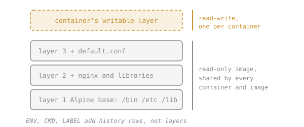

# Images Are Layers

When you pulled nginx, you saw several lines download at once:

```
1f3e46996e29: Pull complete
a7b8c9d0e1f2: Pull complete
...
```

Each line is a **layer**. An image isn't one big file: it's a **stack of layers**, each one a set of file changes on top of the one below.



For example: a bottom layer with a small Linux, then a layer that installs nginx, then a layer with its config files.

The "private scratch space" a container gets (from the last chapter) is just one more thin layer on top, the only one that can be written to.

See an image's layers and what made each one:

```sh
docker history nginx:1.27-alpine
```

Or just count them:

```sh
docker image inspect -f '{{len .RootFS.Layers}}' nginx:1.27-alpine
```

# Assignment

1. Run `docker history nginx:1.27-alpine` and skim it. Each row is a step from when the image was built.
2. Count the layers of `nginx:1.27-alpine` with the `docker image inspect` command above.
3. Add the number to `answers.txt` as a line like `nginx_layers=7`:

   ```sh
   echo "nginx_layers=NUMBER" >> answers.txt
   ```

4. Run, then submit `dk.images.layers`.

(`docker history` shows a few extra rows marked `0B` for settings that add no files, so its row count and the layer count aren't the same. Use the inspect number.)
