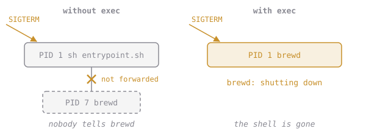

# One Missing Word

The shell's `exec` builtin doesn't start a child process. It **replaces the shell** with the program, keeping the same PID:

```sh
#!/bin/sh
echo "setting up..."     # runs in the shell (PID 1)
exec myprogram "$@"      # myprogram becomes PID 1; the shell is gone
```



So a wrapper script can still do its setup (print a banner, fill in a config file, wait for a database) and then get out of the way. After `exec`, the program is PID 1 and gets `docker stop`'s SIGTERM itself. brewd handles SIGTERM: it logs `brewd: shutting down` and exits 0.

> The other fix is `docker run --init` (you used it in chapter 1): a tiny init process becomes PID 1 and forwards signals. That's useful when you can't change the image. When you can, `exec` is simpler.

## Assignment

1. Fix **`app/entrypoint.sh`** so that brewd replaces the shell. It's one word, and the banner must stay.
2. Rebuild from `Dockerfile.ch5` as **`elixirbytes/brewd:ch5`**.
3. Run it detached as **`eb-web5`**, check `docker exec eb-web5 cat /proc/1/comm` says `brewd`, then **`time docker stop eb-web5`**. It should be well under a second.
4. Submit from `~/elixirbytes`. The checks read your script, `eb-web5`'s exit code and its logs.
