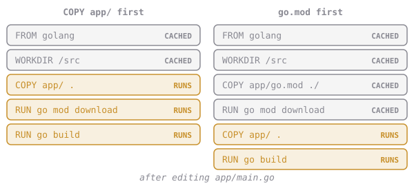

# Order Matters

Real apps use **libraries**: code written by other people. Downloading them can take minutes. Our Dockerfile has a problem with that:

```dockerfile
# copies EVERYTHING, code included
COPY app/ .
RUN go build ...
```

Change one letter of the code and `COPY app/ .` misses the cache, so every step after it runs again. If libraries were downloaded after that line, you'd wait for them on every single build.

The fix: **copy the things that rarely change first, and the things that often change last.** Libraries are listed in `go.mod` (in other languages: `package.json`, `requirements.txt`), which rarely changes. So:



```dockerfile
# 1. just the library list
COPY app/go.mod ./
# 2. download libraries (cached until go.mod changes)
RUN go mod download
# 3. now the code
COPY app/ .
# 4. build
RUN go build ...
```

Our tiny app has no libraries, so `go mod download` finishes in a blink. The habit is what matters: you'll see this pattern in nearly every professional Dockerfile.

# Assignment

In `~/docker-course`:

1. Replace your `Dockerfile`. Copy and paste:

   ```sh
   cat > Dockerfile <<'EOF'
   FROM golang:1.23-alpine
   WORKDIR /src
   COPY app/go.mod ./
   RUN go mod download
   COPY app/ .
   RUN go build -o /usr/local/bin/webapp .
   ENV APP_VERSION=1.1
   ENV GREETING=Welcome
   EXPOSE 8080
   CMD ["webapp"]
   EOF
   ```

2. Build it as **`cq/webapp:cached`**.
3. Pretend you edited the code. This adds a harmless comment line to the end of `main.go`:

   ```sh
   echo "// small change" >> app/main.go
   ```

4. Build again as `cq/webapp:cached`, in plain mode, saving to **`build.log`**:

   ```sh
   docker build --progress=plain -t cq/webapp:cached . 2>&1 | tee build.log
   ```

5. In `build.log`, `RUN go mod download` should say `CACHED`, while `COPY app/ .` and `RUN go build` ran for real.
6. Run, then submit `dk.cache.order-matters`.
