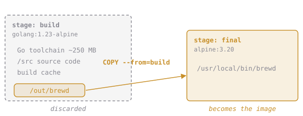

# Build Here, Ship There

A Dockerfile can have several `FROM` lines. Each starts a new **stage** with a fresh filesystem, and **only the last stage becomes the image**. Earlier stages exist only to produce files that later stages copy out:

```dockerfile
FROM golang:1.23-alpine AS build       # stage 1, named "build": has the compiler
WORKDIR /src
COPY app/ .
RUN go build -o /out/brewd .

FROM alpine:3.20                       # stage 2: a clean, small base
COPY --from=build /out/brewd /usr/local/bin/brewd
CMD ["brewd"]
```

`COPY --from=build` copies from the named stage instead of from the build context:



`ARG` belongs to the stage it's declared in. If the final stage needs `BUILD_VERSION` (for the label), declare `ARG BUILD_VERSION` again after its `FROM`.

## Assignment

1. Turn **`~/elixirbytes/Dockerfile`** into a two-stage build:
   - the **build** stage keeps everything from chapter 4: dependencies first, version stamping, the cache mount
   - the **final** stage is **`alpine:3.20`** with only the binary at **`/usr/local/bin/brewd`** and `CMD ["brewd"]`
2. Build it as **`elixirbytes/brewd:slim`** and compare it with `docker images`.
3. Submit from `~/elixirbytes`. The checks compare the image size with a 20 MB budget, look for a `go` binary inside, and run brewd.

> We're keeping the chapter 5 wrapper out of this image for now. The next chapters use `CMD ["brewd"]` directly.
