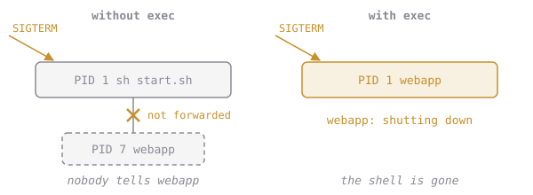

# Who Hears the Stop?

Inside every container, the first process gets the number **PID 1** (process id 1). PID 1 is special:

- When PID 1 exits, the container stops.
- **`docker stop` sends its polite message (SIGTERM) to PID 1, and only PID 1.**

Look inside the slow container while it runs:

```sh
docker run -d --name cq-look cq/webapp:banner
docker exec cq-look ps
# PID   USER     COMMAND
#     1 root     sh /src/start.sh
#     7 root     webapp
docker rm -f cq-look
```



**When you run `docker stop cq-slow`, which process receives the stop message?**
