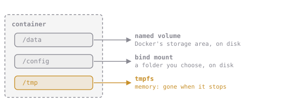

# Bind Mounts

A **bind mount** maps a folder **on your machine** into the container. Both sides see the same files, live:

```sh
docker run --rm --mount type=bind,src="$PWD/notes",dst=/notes alpine:3.20 ls /notes
```



Volumes suit app data and databases: Docker manages them and you refer to them by name. Bind mounts suit files *you* want to edit or read: source code during development, config files, logs.

Two things to know:

- `src` must be an **absolute** path, which is why `$PWD` is there.
- On macOS, Docker runs in a VM that only shares some host folders (usually your home folder). Bind mounts from `~/elixirbytes` work; from `/tmp` they might not.

## Assignment

1. In `~/elixirbytes`, create a folder named **`orders`**.
2. Run **`eb-bind`** from `elixirbytes/brewd:1.6.0`, detached, with **`~/elixirbytes/orders` bind-mounted at `/data`**, published on **`localhost:18088`**.
3. Order a **griffin** potion through it.
4. Open `orders/orders.log` in your editor. It's a normal file on your machine now.
5. Submit from `~/elixirbytes`. The checks inspect the mount, read the file on your side and ask the shop.
