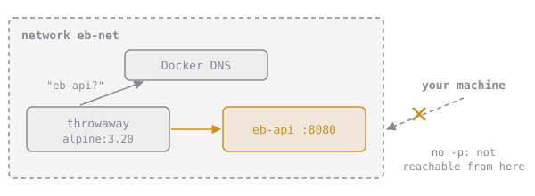

# A Network of Our Own

Create your own network and Docker gives it a **built-in DNS server**. Every container on it can reach the others **by container name**:

```sh
docker network create eb-demo
docker run -d --name eb-a --network eb-demo alpine:3.20 sleep infinity
docker run --rm --network eb-demo alpine:3.20 ping -c1 eb-a
# 64 bytes from 172.19.0.2: seq=0 ttl=64 time=0.1 ms
```



Notice there's no `-p` there. Publishing is for traffic coming **from your machine**. Containers on the same network reach each other's ports directly, so an internal service doesn't need to be published at all, and usually shouldn't be.

## Assignment

1. Create a network named **`eb-net`**.
2. Run **`eb-api`** from `elixirbytes/brewd:1.6.0`, detached, on `eb-net`, with **no published ports**.
3. Check it from a throwaway container on the same network:

   ```sh
   docker run --rm --network eb-net alpine:3.20 wget -qO- http://eb-api:8080/healthz
   ```

4. Submit from `~/elixirbytes`. The checks inspect the network and `eb-api`, then make that same request.
