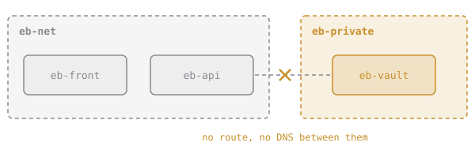

# Keep the Vault Apart

Networks are also walls. Containers on different user-defined networks can't reach each other, or even resolve each other's names, unless a container is attached to both.

That's how you keep the dangerous stuff away from the internet-facing stuff:

A container can join several networks: `docker network connect NET CONTAINER` adds one, and `disconnect` removes it.

## Assignment

ElixirBytes keeps its secret recipes in a vault. For now that's a stand-in container, but the network rules are real.

1. Create a network named **`eb-private`**.
2. Run **`eb-vault`** from `alpine:3.20`, detached, running `sleep infinity`, attached **only** to `eb-private`. Not `eb-net`, and not the default bridge either.
3. Check both sides with `ping -c1 eb-vault` from throwaway containers on each network.
4. Submit from `~/elixirbytes`. The checks inspect `eb-vault`'s networks and ping it from both sides.
