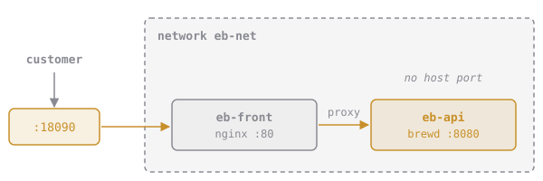

# Front of House

Priya's ticket:

> **NET-3: put a front door on the shop.** Customers talk to **nginx** on port **18090**. nginx forwards everything to brewd. brewd itself must not be published to the host at all: the only way in is through the front door.



nginx needs a config file that tells it where to forward requests. Save this as **`~/elixirbytes/front/default.conf`**:

```nginx
server {
    listen 80;
    location / {
        proxy_pass http://eb-api:8080;
    }
}
```

`proxy_pass http://eb-api:8080` only works if nginx can resolve the name `eb-api`. That's your job.

## Assignment

Using `eb-net` and `eb-api` from earlier in this chapter (recreate them if you need to; `eb-api` must keep its `orders` alias):

1. Make sure **`eb-api`** is running from `elixirbytes/brewd:1.6.0`, attached **only** to `eb-net`, with **no published ports**.
2. Run **`eb-front`** from **`nginx:1.27-alpine`**, detached:
   - on **`eb-net`**
   - with `front/default.conf` mounted **read-only** at **`/etc/nginx/conf.d/default.conf`**
   - with nginx's port **80** published on host port **18090**
3. Self-check: `curl localhost:18090/version` prints `brewd 1.6.0`.

Start `eb-api` before `eb-front`: nginx looks up `eb-api` when it starts and exits if the name doesn't resolve. If `eb-front` keeps exiting, `docker logs eb-front` will say why.

Submit from `~/elixirbytes` to attack. The checks inspect both containers, then make three requests through the front door.

Every check is a hit on the boss. Defeat it to unlock **Compose**.
