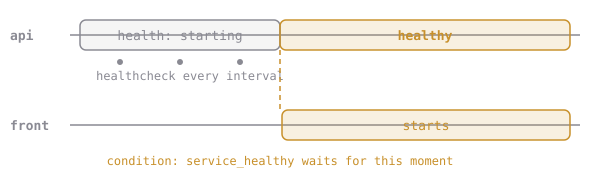

# Healthy Before Open

A **healthcheck** is a command Docker runs *inside* the container on a timer. Exit code 0 means healthy; anything else counts as a failure, and after `retries` failures in a row the container is `unhealthy`.

```yaml
services:
  web:
    healthcheck:
      test: ["CMD", "wget", "-qO-", "http://localhost:8080/healthz"]
      interval: 5s          # how often
      timeout: 2s           # how long one check may take
      retries: 3            # failures in a row before "unhealthy"
      start_period: 5s      # grace period after start; failures don't count yet
```

With `depends_on` and `condition: service_healthy`, a dependent service waits for that `healthy`:



`test` runs inside the container, so the image needs the tool. Our alpine-based image has busybox `wget`, which is why chapter 6 picked alpine.

## Assignment

1. Add a **healthcheck** to the `api` service that fetches `http://localhost:8080/healthz` with `wget`.
2. Add a **`front`** service:
   - image **`nginx:1.27-alpine`**
   - port 80 published on host port **`18092`**
   - `./front/default.conf` mounted read-only at `/etc/nginx/conf.d/default.conf`, with its `proxy_pass` changed to **`http://api:8080`** (the Compose service name)
   - starts only once **`api` is healthy**
3. `docker compose up -d`, then `docker compose ps`. Watch `api` go from `health: starting` to `healthy`.
4. Submit from `~/elixirbytes`. The checks read `docker compose ps` and `docker compose config` and request `/version` through the front door.

> If you changed `front/default.conf`, the chapter 8 `eb-front` container still has the file mounted. Since it now points at `api`, it would break on restart, so `docker rm -f eb-front` is fine at this point.
