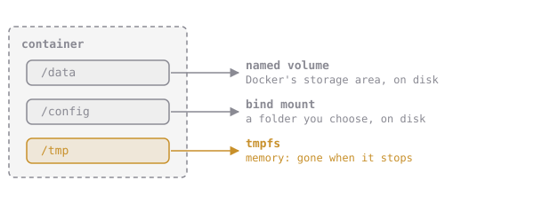

# Volume or Bind Mount?

There are three ways to give a container somewhere to put files:



| | Named volume | Bind mount | tmpfs |
| --- | --- | --- | --- |
| Looks like | `-v cq-notes:/data` | `-v "$(pwd)/site":/site` | `--tmpfs /tmp` |
| Lives | In Docker's storage | In a folder you pick | In memory only |
| Use it for | App data: databases, uploads | Your own files: code while developing, config | Temporary scratch files |

There's also a longer, very clear syntax that you'll see in docs:

```sh
--mount type=volume,source=cq-notes,target=/data
--mount type=bind,source="$(pwd)/site",target=/site
```

It does the same job as `-v`, with every part named.

**You're running a database (Postgres) in a container. Its files live in `/var/lib/postgresql/data`. What should you use?**
