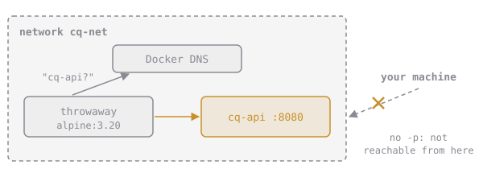

# Your Own Network

Create a network of your own and put containers on it:

```sh
docker network create cq-demo-net
docker run -d --name cq-a --network cq-demo-net cq/webapp:1.6
docker run --rm --network cq-demo-net alpine:3.20 wget -qO- http://cq-a:8080/
# Welcome from webapp 1.6
```

Networks you create come with **Docker DNS**: a built-in phone book. Every container on the network can be reached by its **name**.



Notice there's no `-p` anywhere. Containers on the same network talk to each other directly, on the app's own port. `-p` is only for traffic coming **from your computer**. Leaving it off means the app is reachable by its neighbours but hidden from the outside world, which is exactly what you want for things like databases.

# Assignment

1. Create a network named **`cq-net`**.
2. Start **`cq-api`** from **`cq/webapp:1.6`**, detached, on `cq-net`, **without** publishing any port.
3. Prove it works from a neighbour:

   ```sh
   docker run --rm --network cq-net alpine:3.20 wget -qO- -T 3 http://cq-api:8080/healthz
   ```

4. Run, then submit `dk.networking.user-network`.

(Done with the quiz's `cq-a`? `docker rm -f cq-a`.)
