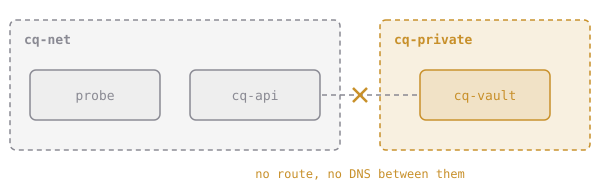

# Keep Them Apart

Networks don't only connect containers. They also keep them **apart**. Containers on different networks can't see each other at all: no route between them, and no name lookup either.



That's a simple, strong security tool. Put the database on a network that only the API joins, and the website container has no way to reach it, even if someone breaks into the website.

(A container can join several networks when it needs to talk to both sides: `docker network connect NETWORK CONTAINER`.)

# Assignment

1. Create a second network, **`cq-private`**.
2. Start **`cq-vault`** from **`cq/webapp:1.6`**, detached, on **`cq-private` only**.
3. Check that it answers from `cq-private`, and can't be found from `cq-net`:

   ```sh
   docker run --rm --network cq-private alpine:3.20 wget -qO- -T 3 http://cq-vault:8080/healthz
   docker run --rm --network cq-net alpine:3.20 wget -qO- -T 3 http://cq-vault:8080/healthz
   # wget: bad address 'cq-vault:8080'
   ```

4. Run, then submit `dk.networking.isolation`.
