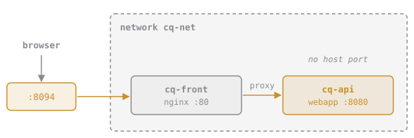

# One Front Door

Big sites don't publish every app to the world. They put one **reverse proxy** at the front door: a web server that takes every visitor's request and passes it to the right app behind it, on the private network.



nginx is a popular reverse proxy. A few lines of config tell it where to send requests:

```nginx
server {
    listen 80;
    location / {
        proxy_pass http://cq-api:8080;
    }
}
```

`proxy_pass` uses the container name, and it works because nginx will sit on `cq-net` next to `cq-api`.

# Assignment

In `~/docker-course`:

1. Create the nginx config. Copy and paste:

   ```sh
   mkdir -p front
   cat > front/default.conf <<'EOF'
   server {
       listen 80;
       location / {
           proxy_pass http://cq-api:8080;
       }
   }
   EOF
   ```

2. Start **`cq-front`** from **`nginx:1.27-alpine`**, detached, on **`cq-net`**, published on port **8094**, with your **`front`** folder mounted **read-only** at **`/etc/nginx/conf.d`** (where nginx looks for its settings).
3. Open http://localhost:8094. That's the webapp, reached through the front door. `cq-api` itself is still not published.
4. Run, then submit `dk.networking.reverse-proxy`.

If `cq-front` exits straight away, read `docker logs cq-front`. nginx refuses to start when it can't find `cq-api`, so check that `cq-api` is running on `cq-net`.
