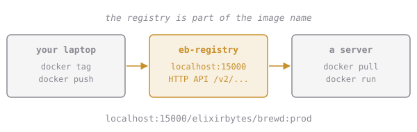

# Our Own Registry

Saving tarballs (chapter 2) works, but production machines pull from a **registry**. Docker Hub is one; GitHub, every cloud provider and `registry:2`, a tiny open-source one you can run yourself, are others.

The registry is part of the image name. To push somewhere other than Docker Hub, tag the image with the registry's host and port first:

```sh
docker tag elixirbytes/brewd:prod localhost:15000/elixirbytes/brewd:prod
docker push localhost:15000/elixirbytes/brewd:prod
```

The first part of the name is the registry because it contains a `:`. Docker reads `localhost:15000/elixirbytes/brewd:prod` as registry `localhost:15000`, repository `elixirbytes/brewd`, tag `prod`. Without a host in front, a name means Docker Hub.



A registry is just an HTTP API:

```sh
curl localhost:15000/v2/_catalog                       # repositories
curl localhost:15000/v2/elixirbytes/brewd/tags/list    # tags of one repository
```

Docker only allows plain-HTTP registries at `localhost` by default. Anything else needs HTTPS, which is a good default.

## Assignment

1. Run **`eb-registry`** from **`registry:2`**, detached, with its port **5000** published on **`127.0.0.1:15000`** only.
2. Tag `elixirbytes/brewd:prod` for that registry and **push** it.
3. Submit from `~/elixirbytes`. The checks inspect the registry container and ask the registry's API for the repository and the tag.
