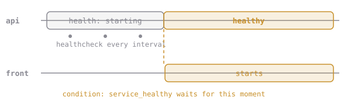

# Wait Until It's Healthy

A **healthcheck** is a small command Docker runs inside the container every few seconds to ask "are you OK?". Exit code 0 means healthy. Our webapp has `/healthz` for exactly this:

```yaml
    healthcheck:
      test: ["CMD", "wget", "-qO-", "http://localhost:8080/healthz"]
      interval: 5s
```

Then another service can wait for it properly:

```yaml
    depends_on:
      api:
        condition: service_healthy
```



Inside a Compose project, services find each other by **service name**: the nginx config just says `http://api:8080`.

# Assignment

In `~/docker-course`:

1. Create the front door's config. Copy and paste:

   ```sh
   mkdir -p proxy
   cat > proxy/default.conf <<'EOF'
   server {
       listen 80;
       location / {
           proxy_pass http://api:8080;
       }
   }
   EOF
   ```

2. Replace `compose.yaml`. Copy and paste:

   ```sh
   cat > compose.yaml <<'EOF'
   services:
     api:
       build: .
       image: cq/webapp:compose
       ports:
         - "8097:8080"
       environment:
         GREETING: Hello from Compose
         DATA_DIR: /notes
       volumes:
         - notes:/notes
       healthcheck:
         test: ["CMD", "wget", "-qO-", "http://localhost:8080/healthz"]
         interval: 5s
         timeout: 3s
         retries: 3

     front:
       image: nginx:1.27-alpine
       ports:
         - "8098:80"
       volumes:
         - ./proxy:/etc/nginx/conf.d:ro
       depends_on:
         api:
           condition: service_healthy

   volumes:
     notes:
   EOF
   ```

3. Run `docker compose up -d`, then `docker compose ps` a few times. Watch `api` go from `health: starting` to `healthy`, and only then does `front` start.
4. Open http://localhost:8098.
5. Run, then submit `dk.compose.healthy-first`.
