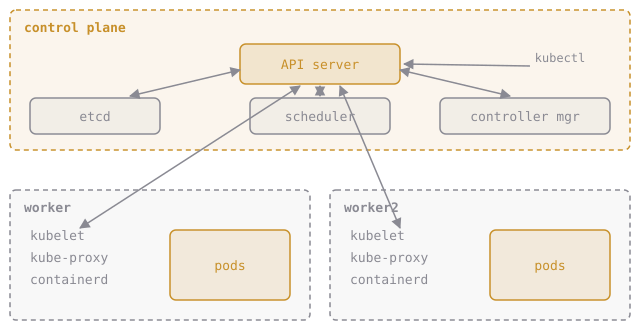

# Who Does What in the Cluster

A cluster has two halves.

**Control plane** (the brain, on `elixirbytes-control-plane`):

- **API server**: the front door. Every request, from you or from another component, goes here. It checks who you are and whether you're allowed, validates the object, and saves it.
- **etcd**: the database holding the whole cluster's state. Only the API server talks to it. Lose etcd and the cluster forgets everything.
- **Scheduler**: picks a node for each new pod. It decides; it doesn't start anything.
- **Controller manager**: runs **controllers**, small loops that compare what you asked for with what exists and fix the difference. This loop is called **reconciliation**, and the whole system is built on it.

**Worker nodes** (where your containers run):

- **kubelet**: the agent on every node. It starts the containers the API server assigns to its node, watches their health and reports back.
- **container runtime**: what actually runs containers (containerd here). Images you build with `docker build` run fine; Docker itself isn't in the path.
- **kube-proxy**: sets up the networking rules that make Services work (chapter 4).

The components mostly **watch** the API server: they keep a connection open and get told when something they care about changes.

**You run `kubectl apply -f pod.yaml`. What happens, in order?**
